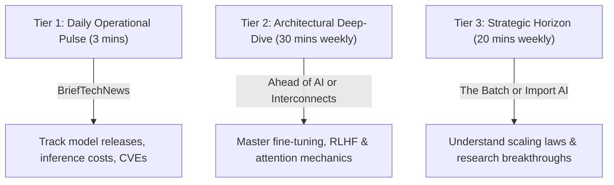

The AI newsletter market is flooded with garbage.

If you search for "best AI newsletters" on Google, nine out of ten recommendations point to affiliate-driven aggregate blogs designed for non-technical hype chasers. They promise "10 secret prompts to automate your marketing agency," share speculative essays on the existential timeline of AGI, or review consumer image generation wrappers that will be obsolete in sixty days.

For software engineers, machine learning practitioners, and platform architects actually building production AI systems in 2026, these newsletters are worse than useless—they are an active waste of mental RAM.

When you are architecting a multi-agent coding pipeline, optimizing vLLM inference latency on an H100 cluster, evaluating FP8 quantization loss, or benchmarking open-weight models against SWE-bench and TerminalBench, you need hard engineering data.

Here are the best technical AI newsletters that respect your intelligence and focus on real engineering rigor.

---

## What Makes an AI Newsletter Worth Reading for Developers?

Before evaluating individual publications, here is the technical rubric we used to separate engineering signal from venture capital hype:

1. **Benchmark Transparency**: Does the publication report standardized, reproducible benchmarks (TerminalBench, SWE-bench Verified, HumanEval, MMLU-Pro), or do they parrot cherry-picked marketing claims from corporate press releases?
2. **Inference Economics & Hardware Realities**: Do they discuss the actual cost of running models—token throughput, KV cache memory pressure, FP8 vs. INT4 quantization, and GPU cluster requirements?
3. **Open-Weights & Self-Hosting Focus**: Do they cover open-source foundation models (DeepSeek, Llama, Ripple, Mistral, Qwen) and local serving engines (vLLM, TensorRT-LLM, Ollama, SGLang)?
4. **Agent Architectures & Systems Engineering**: Do they analyze deterministic guardrails, structured JSON outputs, tool-calling latencies, and autonomous error recovery—or just "chat interfaces"?

---

## Technical AI Newsletters: Ranked Comparison

| Newsletter | Cadence | Primary Focus | Best For | Technical Rigor |
| :--- | :--- | :--- | :--- | :--- |
| **BriefTechNews (AI Beat)** | Daily (Mon–Fri) | Model releases, inference costs, benchmarks, CVEs | Full-stack & infrastructure engineers building with AI | 9.7 / 10 |
| **Ahead of AI (Sebastian Raschka)** | Bi-weekly | Deep-dive architectures, LoRA/QLoRA code, training math | ML engineers & data scientists implementing models | 9.6 / 10 |
| **The Batch (Andrew Ng / DeepLearning.AI)** | Weekly | Research paper teardowns, industry deployments | Engineers transitioning into applied AI | 9.0 / 10 |
| **Import AI (Jack Clark)** | Weekly | Frontier compute scaling, safety benchmarks, policy | Research scientists & technical leadership | 9.2 / 10 |
| **Interconnects (Nathan Lambert)** | Weekly | Post-training RL, RLHF/DPO mechanics, open weights | Alignment engineers & LLM post-training specialists | 9.5 / 10 |

---

## 1. BriefTechNews: The Daily Operational AI Pulse

- **Cadence**: Daily (every morning)
- **Author/Team**: BriefTechNews Engineering Editorial
- **Primary Focus**: Benchmarks, open-weight model releases, inference costs, and DevOps impact
- **Price**: Free (Web & Native iOS/Android App)

[BriefTechNews](https://brief-tech-news.com/) provides the fastest daily technical pulse for practicing developers. While other AI digests drown you in speculative essays about AI ethics and corporate board appointments, BriefTechNews cuts straight to the engineering facts.

Every morning, the AI beat delivers:
- **Model Releases & Weights**: Direct links to Hugging Face model repositories, license restrictions (e.g., Apache 2.0 vs. customized commercial caps), and context window capabilities.
- **Empirical Benchmarks**: Standardized comparisons (e.g., TerminalBench 2.1 for coding agents, GSM8K, SWE-bench) alongside training compute costs and parameter counts.
- **Inference & DevOps Integration**: How the latest model impacts production architectures. Can you run it on 2x H100 80GB nodes via vLLM? What is the token/sec latency at FP8? Does it support native function calling?

```text
BriefTechNews Story Structure:
[Headline]: Model Name + Benchmark Score + Compute Cost
[Summary]: Architecture type (MoE vs Dense), parameter count, context window size
[Deployment]: Hardware specs for FP8/INT4 serving via vLLM / TensorRT-LLM
[Direct Links]: Upstream weights repo + reproducibility paper + eval harness
```

For mobile users, the [BriefTechNews mobile swiper app](https://brief-tech-news.com/) lets you skim these technical cards in 3 minutes during your morning commute, swipe to save critical model repos into your local read-later stash, and use the built-in AI technical assistant to interrogate benchmark methodologies directly.

**Best for**: Software engineers, SREs, and technical leads who need daily situational awareness of AI breakthroughs without reading 50-page research papers every morning.

---

## 2. Ahead of AI (Sebastian Raschka)

- **Cadence**: Bi-weekly
- **Author**: Sebastian Raschka (Staff Research Engineer at Lightning AI, author of *Build a Large Language Model (From Scratch)*)
- **Primary Focus**: Model architectures, fine-tuning methodologies, attention mechanics, and PyTorch implementations
- **Price**: Free tier; paid tier for extended deep dives

Sebastian Raschka is one of the most respected educators and practitioners in modern machine learning. *Ahead of AI* is not a news aggregator; it is an ongoing masterclass in LLM engineering.

Each issue takes a complex architectural topic—such as LoRA vs. DoRA parameter-efficient fine-tuning, mixture-of-experts (MoE) routing algorithms, direct preference optimization (DPO), or multi-token prediction heads—and breaks it down with clear mathematical intuition, architectural flowcharts, and standalone PyTorch code snippets.

```python
# Raschka style: Concrete architectural implementation details
class LoRALayer(nn.Module):
    def __init__(self, in_dim, out_dim, rank=4, alpha=8):
        super().__init__()
        self.A = nn.Parameter(torch.randn(in_dim, rank) / math.sqrt(rank))
        self.B = nn.Parameter(torch.zeros(rank, out_dim))
        self.scaling = alpha / rank
        
    def forward(self, x):
        return (x @ self.A @ self.B) * self.scaling
```

If you are fine-tuning models on proprietary datasets or trying to understand why your quantized model is losing coherence on structured output tasks, Sebastian's technical breakdowns are gold standard reading.

**Best for**: Machine learning engineers, data scientists, and backend developers who want to understand the mathematical and architectural internals of modern transformer models.

---

## 3. Interconnects (Nathan Lambert)

- **Cadence**: Weekly
- **Author**: Nathan Lambert (AI Research Scientist at the Allen Institute for AI, ex-Hugging Face)
- **Primary Focus**: Post-training reinforcement learning, RLHF, DPO, open-weights governance, and benchmark validity
- **Price**: Free tier; paid subscription for deep-dive archives

As models commoditize at the pre-training layer, the real competitive differentiation in 2026 has shifted to **post-training**: instruction tuning, preference optimization, reasoning loops (chain-of-thought fine-tuning), and synthetic data generation.

*Interconnects* focuses heavily on this post-training frontier. Nathan Lambert provides an insider's view of how modern frontier models are aligned, evaluated, and open-sourced. 

He is particularly known for his rigorous, unsparing critiques of benchmark contamination, eval gaming, and the subtle ways companies inflate leaderboard scores. If you want to know whether a new reasoning benchmark actually proves architectural superiority or just overfit test set leakage, read Interconnects.

**Best for**: Research engineers, AI safety practitioners, and teams building custom fine-tuning and alignment pipelines.

---

## 4. The Batch (DeepLearning.AI)

- **Cadence**: Weekly (every Wednesday)
- **Author/Team**: Andrew Ng and the DeepLearning.AI Editorial Team
- **Primary Focus**: Curated AI research paper breakdowns, business deployments, and foundational ML concepts
- **Price**: Free

Founded by AI pioneer Andrew Ng, *The Batch* is one of the longest-running and most polished technical publications in artificial intelligence.

The editorial team selects three to four significant machine learning papers each week and translates them into a standardized four-part structure:
1. **What's New**: The core hypothesis or architecture introduced.
2. **How It Works**: The algorithmic mechanisms, loss functions, and data pipelines.
3. **Results**: Empirical benchmark gains over baseline models.
4. **Why It Matters**: The practical application for real-world engineering systems.

Andrew Ng also writes a weekly personal column that grounds the research in pragmatic engineering and business reality. It is accessible without being dumbed down, making it the ideal publication for software engineers transitioning into applied machine learning.

**Best for**: Full-stack developers, engineering managers, and practitioners who want a reliable weekly bridge between academic research and commercial software.

---

## 5. Import AI (Jack Clark)

- **Cadence**: Weekly (every Monday)
- **Author**: Jack Clark (Co-founder of Anthropic, former Policy Director at OpenAI)
- **Primary Focus**: Frontier compute clusters, training scaling laws, security capabilities, and AI governance
- **Price**: Free

Written by Anthropic co-founder Jack Clark, *Import AI* is a foundational newsletter for anyone who needs to understand the macro trajectory of artificial intelligence.

Jack approaches AI from a systems-level and geopolitical perspective. Each issue analyzes:
- Breakthroughs in autonomous code generation and automated vulnerability discovery (e.g., AI pipelines finding and patching Linux local privilege escalations).
- Compute economics: gigawatt-scale data center infrastructure, specialized silicon, and hardware interconnects.
- The evolving capabilities of autonomous agents in terminal environments.

What makes Import AI unique is Jack's technical precision paired with high-level strategic perspective. He reads obscure research papers from labs worldwide and synthesizes what their findings mean for software development over the next three to five years.

**Best for**: Systems architects, engineering executives, and senior developers thinking about long-term technical strategy and frontier model capabilities.

---

## How to Build a High-Signal AI Information Diet

Trying to follow every paper on arXiv or every Hugging Face model drop will drown your productivity. Here is how senior practitioners structure a sustainable 3-tier AI reading stack:



### 1. The Daily Operational Pulse (3 minutes)
- **Source**: [BriefTechNews AI Beat](https://brief-tech-news.com/) (Email or Mobile Swiper).
- **Goal**: Immediate situational awareness. Check if a new open-weights model or quantization kernel reduces your inference budget, or if a critical zero-day affects your orchestration stack.

### 2. The Architectural Deep Dive (30 minutes weekly)
- **Source**: *Ahead of AI* (Sebastian Raschka) or *Interconnects* (Nathan Lambert).
- **Goal**: Ongoing technical mastery. Spend your Friday afternoon understanding how a specific fine-tuning algorithm or attention mechanism actually works in code.

### 3. The Strategic Horizon (20 minutes weekly)
- **Source**: *The Batch* or *Import AI*.
- **Goal**: Long-term architectural planning. Understand where compute scaling is heading so you can design systems that will benefit from next year's model capabilities rather than being made obsolete by them.

---

## Stop Reading Prompt Lists; Start Reading Architecture

The difference between a script kiddie and a professional AI engineer is the depth of their mental models.

Prompt lists and generic AI digests treat machine learning as magic. Technical publications like BriefTechNews, Ahead of AI, and Interconnects treat it as systems engineering: governed by memory bandwidth, compute budgets, loss functions, and empirical latency curves.

Upgrade your information diet, prune the hype from your inbox, and build your stack on verified engineering signal.
