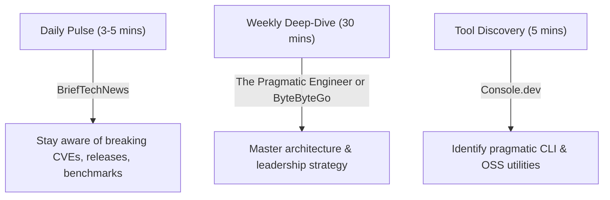

Most tech newsletters are written for the wrong audience. 

If you are a working software engineer, site reliability engineer, or engineering manager, your primary bottleneck is never a lack of information. Your bottleneck is attention. Every morning, your feeds compete to dump thousands of words of speculative commentary, regurgitated PR wire posts, and affiliate-laden prompt lists into your inbox.

You do not need more reading material. You need a higher signal-to-noise ratio.

When a major cloud provider rolls out an API breaking change, when a severe Linux kernel privilege escalation is disclosed, or when a new open-weights model cuts inference cost per token by 60%, you need to know about it. You do not need three paragraphs of editorial filler speculating on corporate politics or twenty links to superficial Medium thinkpieces.

We evaluated the top technical publications, newsletters, and digests targeting developers in 2026. Here is the definitive ranking based on technical density, editorial honesty, and respect for your time.

---

## The Signal-to-Noise Framework for Developers

To rank these publications fairly, we assessed each across four concrete criteria:

1. **Technical Density**: Does the issue discuss architecture, latency, protocols, failure modes, and code—or does it traffic in executive summaries and corporate hype?
2. **Primary Sourcing**: Does the newsletter link directly to the underlying GitHub repository, CVE advisory, whitepaper, or post-mortem? Or does it bounce you through three SEO aggregator blogs?
3. **Time-to-Value (Velocity)**: Can you extract the core takeaways in under 5 minutes during your morning routine, or does it require a 40-minute Sunday commitment?
4. **Editorial Independence**: Are sponsor placements transparently segregated, or do paid tools disguise themselves as organic editorial recommendations?

---

## Quick Comparison Matrix

| Newsletter | Cadence | Avg. Read Time | Best For | Signal-to-Noise Score |
| :--- | :--- | :--- | :--- | :--- |
| **BriefTechNews** | Daily (Mon–Fri) | 3–5 mins | Multi-beat daily pulse without inbox clutter | 9.6 / 10 |
| **The Pragmatic Engineer** | Weekly | 25–40 mins | Engineering management & Big Tech career dynamics | 9.4 / 10 |
| **ByteByteGo** | Weekly | 10–15 mins | Visual system design & distributed architecture | 9.1 / 10 |
| **Console.dev** | Weekly | 5–8 mins | Vetted open-source developer tools and CLI utilities | 8.8 / 10 |
| **TLDR Tech** | Daily | 5 mins | Broad general tech scan across diverse link categories | 7.9 / 10 |
| **Quastor** | Twice weekly | 8–12 mins | Deep dives into real-world production post-mortems | 8.7 / 10 |

---

## 1. BriefTechNews: The Highest Velocity Daily Pulse

- **Cadence**: Daily (every weekday morning)
- **Format**: Curated multi-beat briefings + native swipeable mobile application
- **Primary Focus**: AI models & inference, DevOps & cloud infrastructure, Systems IT, Tech industry moves
- **Pricing**: Free

[BriefTechNews](https://brief-tech-news.com/) solves the biggest flaw in daily developer news: feed fragmentation. Most daily digests force you to either subscribe to four different specialized newsletters (one for AI, one for DevOps, one for general tech) or drown in a 3,000-word daily scroll.

BriefTechNews organizes daily technical developments into clean, domain-specific beats—AI, DevOps, IT, Tech, Crypto, Fintech, and Founders. Each story is reduced to its core engineering facts: what shipped, the benchmark numbers, the architectural tradeoffs, and the direct source link (PRs, research papers, incident reports).

```text
Typical BriefTechNews Breakdown:
[Model Release] -> Inference latency vs FP8 baseline -> GitHub repo
[Security Advisory] -> CVE ID & CVSS score -> Patch commit diff
[Cloud Pricing] -> Egress rate changes -> Provider calculator
```

For engineers who refuse to check work email first thing in the morning, the [BriefTechNews mobile app](https://brief-tech-news.com/) provides a card-swipe interface modeled after code reviews: skim the headline, read the two-sentence technical impact, swipe to save to your local read-later stash, or tap through directly to the raw documentation.

**Best for**: Senior engineers, architects, and technical leads who need complete cross-stack situational awareness before their morning standup without spending more than 5 minutes.

---

## 2. The Pragmatic Engineer (Gergely Orosz)

- **Cadence**: Weekly (Tuesday & Thursday deep dives)
- **Format**: Long-form investigative engineering essays
- **Primary Focus**: Big Tech hiring, engineering compensation, org design, system migration teardowns
- **Pricing**: Free tier; $15/month or $150/year for full archives

Run by former Uber engineering manager Gergely Orosz, *The Pragmatic Engineer* is currently the most popular paid software engineering publication on Substack, and for good reason. Gergely treats software engineering not as an academic pursuit, but as an economic and organizational reality.

Rather than summarizing the week's top headlines, each issue is an exhaustive reported piece. Recent topics include deep analyses of Big Tech performance review calibrations, how Uber re-architected its ledger service, and real surveys on engineering compensation across Europe and North America.

> "A senior engineer's job is not just writing clean functions; it is understanding how business priorities, team structures, and architectural debt interact."

**Tradeoffs**: It is not a quick daily briefing. A single issue can take 30 to 45 minutes to digest. If you are preparing for system design interviews, transitioning into engineering leadership, or trying to benchmark your team against Silicon Valley standards, it is indispensable.

**Best for**: Mid-to-senior engineers looking to understand the macro economics and organizational mechanics of the tech industry.

---

## 3. ByteByteGo (Alex Xu)

- **Cadence**: Weekly
- **Format**: Visual architectural diagrams paired with structural breakdowns
- **Primary Focus**: System design, distributed systems, database internals
- **Pricing**: Free tier; paid subscription for complete system design archive

Alex Xu (author of the *System Design Interview* book series) produces *ByteByteGo*, which transforms abstract distributed systems concepts into visual architecture flowcharts.

If you have ever needed to explain Paxos vs. Raft consensus to a junior engineer, understand how Discord handles millions of concurrent voice connections, or see how payment gateways prevent double-spending with idempotency keys, ByteByteGo breaks it down visually.

```
Client ---> [API Gateway / Rate Limiter]
                  |
         +--------+--------+
         |                 |
  [Payment Service]  [Ledger Service]
         |                 |
    (Idempotency)     (Immutable WAL)
         v                 v
   [Redis Lock]      [Postgres HA]
```

The diagrams are clean, modular, and memorable. While it rarely covers breaking day-to-day tech news, it consistently improves your core software architecture fundamentals.

**Best for**: Backend engineers, distributed systems developers, and anyone studying for high-scale architectural design reviews.

---

## 4. Console.dev

- **Cadence**: Weekly (every Thursday)
- **Format**: Short, curated reviews of developer tools, CLI utilities, and open-source libraries
- **Primary Focus**: Tooling, developer productivity, open-source infrastructure
- **Pricing**: Free

Finding reliable open-source tools before they blow up on Hacker News is tough. *Console.dev* focuses exclusively on developer tooling. 

Each issue spotlights three to four curated tools. Instead of regurgitating the repository's `README.md`, the Console team tests the tool, notes its performance characteristics, inspects its license, and interviews the core maintainer about why they built it.

They cover everything from modern Rust-based terminal emulators and terminal file managers to lightweight eBPF observability daemons and SQLite extensions.

**Best for**: DevOps practitioners, tooling enthusiasts, and developers who love refining their terminal environment and developer workflow.

---

## 5. TLDR Tech

- **Cadence**: Daily (every morning)
- **Format**: Categorized bullet-point link digest
- **Primary Focus**: General technology, startup funding, AI developments, web development
- **Pricing**: Free (ad-supported)

*TLDR* is one of the most widely subscribed developer newsletters on the internet. Founded by Dan Ni, it delivers a punchy bulleted list of 10 to 12 links categorized by Big Tech news, programming articles, and futuristic science.

Each item features a headline, a two-to-three-sentence summary, and an estimated reading time. The main challenge with TLDR is scale: because it caters to a massive audience ranging from junior frontend developers to product managers and tech recruiters, the technical depth varies wildly. A link to a deep Linux eBPF memory leak analysis might sit right next to an article about consumer smartphone design.

Additionally, TLDR has split into over a dozen sub-newsletters (TLDR AI, TLDR WebDev, TLDR DevOps, TLDR Design). Subscribing to multiple editions quickly creates the exact inbox bloat you were trying to escape.

**Best for**: Engineers who want a quick, broad overview of tech culture and do not mind skimming past non-technical items.

---

## 6. Quastor

- **Cadence**: Twice weekly
- **Format**: Summary case studies of engineering blogs and academic papers
- **Primary Focus**: Production architecture, real-world outages, software engineering case studies
- **Pricing**: Free tier; paid deep-dive archives

Large technology companies like Netflix, Uber, Meta, and Cloudflare publish incredible engineering blogs, but few engineers have time to read 15 company engineering blogs each week.

*Quastor* summarizes these company engineering posts into digestible breakdowns. Rather than simple links, Quastor extracts:
- What problem the engineering team faced (e.g., database connection pool exhaustion at peak load).
- The alternatives they considered.
- The architectural solution they deployed.
- The concrete operational lessons learned.

It is one of the fastest ways to learn from other teams' production mistakes without causing an incident of your own.

**Best for**: Backend and infrastructure engineers who want actionable architectural case studies without scouring dozens of corporate blogs.

---

## How to Structure Your Engineering Information Diet

Consuming too many newsletters creates passive information anxiety—the illusion of learning without actual retention or execution.

Here is a sustainable 3-tier reading framework used by senior engineers:



### Tier 1: The Daily Operational Pulse (3–5 minutes)
- **Tool**: [BriefTechNews](https://brief-tech-news.com/) (Email or Mobile Swiper).
- **Rule**: Read it once during your morning routine. Look for breaking security advisories, major library deprecations, or infrastructure price changes that affect your current tech stack. Never open rabbit holes before your first commit of the day.

### Tier 2: The Weekly Architecture Deep-Dive (30 minutes)
- **Tool**: *The Pragmatic Engineer*, *ByteByteGo*, or *Quastor*.
- **Rule**: Schedule a dedicated 30-minute block on Friday afternoon or Monday morning. Read one substantive architectural breakdown or post-mortem. Take notes in your team's engineering knowledge base if the lesson applies to your roadmap.

### Tier 3: The Tooling & Library Review (10 minutes bi-weekly)
- **Tool**: *Console.dev*.
- **Rule**: Skim for utilities that solve immediate friction in your CI pipeline, local development container, or terminal workflow. If an open-source tool does not solve an immediate pain point, ignore it.

---

## The Golden Rule: Ruthless Unsubscribing

If a newsletter sits unread in your inbox for three consecutive editions, **unsubscribe immediately**. Do not mark it as read; do not archive it into a "Read Later" folder that you will never open.

Your engineering value is measured by the quality of the systems you design and ship, not by how many browser tabs you keep open. Pick two high-signal sources, automate or batch their delivery, and protect your focus for deep work.
