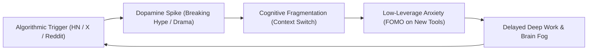
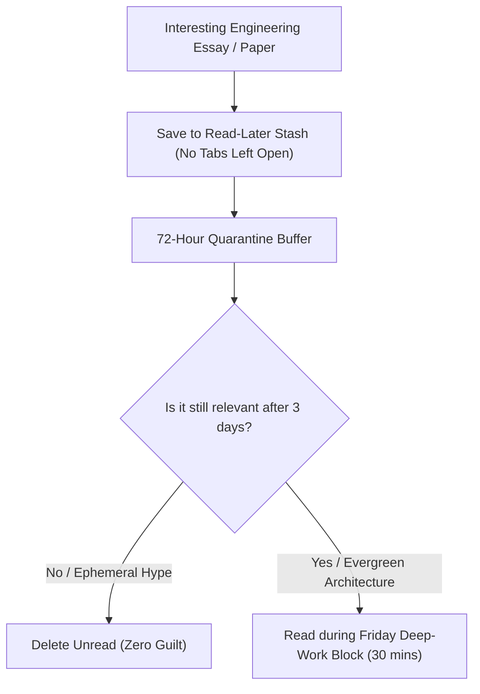

Every software engineer knows the browser reflex. 

You finish writing a unit test, you hit save, you wait 45 seconds for your local test suite or Docker build to compile, and your fingers automatically execute the muscle memory: `Cmd + T`, `news.ycombinator.com`, `Enter`.

Or you open X/Twitter "just to see if AWS is having an outage," and twenty minutes later you are reading a 40-tweet thread arguing whether TypeScript is killing developer productivity or whether junior engineers will be obsolete by next Tuesday.

We tell ourselves this is "staying informed." We tell ourselves that as technical professionals in an industry that moves fast, constant scanning is necessary to remain competitive.

It is a lie.

Constantly monitoring the firehose is not learning; it is **algorithmic doomscrolling disguised as professional diligence**. It destroys your focus, pollutes your working memory with manufactured urgency, and burns out your cognitive reserves before you write a single meaningful commit.

Senior engineers do not stay effective by reading everything. They stay effective by engineering their information diet with the same discipline they apply to production distributed systems.

Here is the exact 4-step protocol to stay informed on software engineering developments without losing your mind or your mornings.

---

## The Hidden Cost of the Developer Firehose

Before fixing the system, consider what unstructured information consumption actually costs:



### 1. Attentional Fragmentation (Context Switching Tax)
Research across cognitive psychology shows that it takes an average of 23 minutes to regain deep focus after a distraction. When you check technical feeds five or six times throughout your workday, you never reach a state of flow. You spend your entire day operating in shallow, fragmented bursts.

### 2. The Fallacy of "Just-in-Case" Learning
Reading about an obscure distributed database or a new frontend build tool that you have no immediate plan to deploy is "just-in-case" learning. By the time you actually need that tool two years from now, the API will have changed, the maintainers will have rewritten it in Rust, or the project will be abandoned. 

### 3. Artificial Urgency and Tech Burnout
Technical social media algorithms are optimized for engagement, and engagement is driven by anxiety and conflict. Headlines frame every minor framework release as a career-threatening paradigm shift. Absorbing this panic daily leads directly to technical exhaustion.

---

## The 4-Step Senior Engineer Protocol

To replace dopamine-driven doomscrolling with clean, actionable engineering signal, adopt this four-step pipeline:

```
[ Algorithmic Feeds ] ---> [ BLOCKED ]
                                |
[ Primary Sources & Curated Beats ] ---> [ Step 2: 10-Min Morning Batch ]
                                                  |
                                                  +---> (Actionable Today? Apply/Alert)
                                                  |
                                                  +---> (High Quality Deep-Dive? Quarantine 72h)
                                                  |
                                                  +---> (Noise/Fluff? Delete Immediately)
```

---

## Step 1: Eliminate Algorithmic Push Feeds

Algorithmic feeds (Twitter/X, LinkedIn, Reddit, YouTube recommendations) have one engineering objective: maximize time on platform. They do not optimize for the accuracy of information, the density of engineering insights, or your mental clarity.

If an information source uses an algorithm to determine what appears on your screen, **remove it from your work environment**.

### Concrete Actions:
1. **Remove bookmarks from your browser toolbar**: If `news.ycombinator.com` or `x.com` is in your bookmark bar, delete it. Friction is your best defense against unconscious muscle memory.
2. **Install a domain blocker during working hours**: Use tools like `SelfControl` (macOS), `Cold Turkey` (Windows), or simple `/etc/hosts` aliases to block social feeds between 8:00 AM and 5:00 PM.
3. **Turn off all mobile notifications for news apps**: No technical news is urgent enough to justify interrupting your thought process. If a primary data center catches fire, your PagerDuty will alert you.

---

## Step 2: Establish the 10-Minute Daily Batch Ritual

You do not need continuous updates throughout the day. The tech industry does not move in milliseconds; it moves in weekly release cycles and monthly deployment milestones.

Replace continuous monitoring with a **single, time-boxed 10-minute morning batch ritual**.

### How to Run the Morning Batch:
- **When**: During your first cup of coffee, strictly *before* you open your IDE, Slack, or email.
- **Where**: Outside of your email inbox. Use a dedicated tool like the [BriefTechNews mobile swiper app](https://brief-tech-news.com/) or an RSS reader.
- **The Filter**: As you review the day's updates across AI, DevOps, IT, and Tech, look exclusively for three things:
  1. **Security Vulnerabilities (CVEs)**: Does this affect our infrastructure stack (Kubernetes, Linux kernels, cloud SDKs)?
  2. **Major Upstream Releases**: Did a database engine or framework we use in production just publish a breaking upgrade?
  3. **Empirical Benchmarks & Cost Drops**: Did an open-weights model or cloud provider shift the economics of our current architecture?

If an item does not meet those three criteria, swipe past it. Do not open tabs. In under 5 minutes, your daily situational awareness is complete. Close the app and start building.

---

## Step 3: Implement the 72-Hour Read-Later Quarantine

The most dangerous productivity trap for developers is the **"tab bankruptcy" death spiral**: opening 25 browser tabs of long-form technical blogs, keeping them open for three weeks, feeling guilty about not reading them, and eventually closing them all in disgust.

The antidote is the **72-Hour Read-Later Quarantine**.



### The Rules of the Quarantine:
1. **Never read long-form essays during the work day**: If an article looks profound, save it to a read-later tool (like the BriefTechNews in-app save stash, Pocket, or a simple markdown scratchpad) and **close the browser tab immediately**.
2. **Let it sit for 72 hours**: Ephemeral hype decays rapidly. The article claiming that "Architecture X Changes Everything" will seem completely uninteresting three days later.
3. **The Friday Afternoon Reading Block**: Set aside 30 minutes on Friday afternoon to process your queue. Scan your saved items. If an article still feels critical to your architectural understanding after 72 hours, read it. If not, hit delete with zero guilt.

Over 80% of quarantined articles will be deleted unread—saving you dozens of hours of unnecessary cognitive overhead each month.

---

## Step 4: Shift from "Just-in-Case" to "Just-in-Time" Learning

Senior engineers have vast mental maps of *what is possible*, but relatively little stored memory of *exact API syntaxes*.

When you switch your mindset from **Just-in-Case learning** (trying to know everything in advance) to **Just-in-Time learning** (mastering a tool precisely when you need to ship it), your information diet shrinks by 90%.

### How to Practice Just-in-Time Learning:
- **Build indexing knowledge, not detailed knowledge**: When skimming [BriefTechNews](https://brief-tech-news.com/), you only need to register: *"A new open-weights model called Ripple-65B hit state-of-the-art on TerminalBench for $32M compute."* You do not need to memorize its FP8 quantization matrix parameters today.
- **Store pointers, not implementations**: Keep a personal notes repository (Obsidian, Logseq, or flat Markdown files). When you see an exceptional post-mortem on database connection pooling, save the link under `#architecture/pooling`.
- **Dive deep only upon implementation**: When your team decides to build an AI code agent or re-architect your connection pool next quarter, *that* is the exact moment you pull out the pointer, read the technical whitepaper, inspect the GitHub repo, and master the mechanics.

---

## The Information Diet Audit: Rate Your Channels

Take five minutes right now to audit your current technical inputs:

| Channel | Signal Density | Distraction Risk | Actionable Impact | Verdict |
| :--- | :--- | :--- | :--- | :--- |
| **Hacker News Frontpage** | Moderate (4/10) | Extreme | Rare (drowned in comments) | **Block during day** |
| **Tech Twitter / X** | Low (2/10) | Extreme | Almost zero (rage bait) | **Eliminate from phone** |
| **BriefTechNews Daily** | High (9.5/10) | Zero | Immediate (CVEs & metrics) | **Keep (5-min morning batch)** |
| **The Pragmatic Engineer** | High (9/10) | Low | Strategic (career & orgs) | **Keep (weekly quarantine block)** |
| **Vendor PR Newsletters** | Low (1/10) | Moderate | Negative (marketing fluff) | **Unsubscribe immediately** |
| **Tech Subreddits (r/programming)** | Low (3/10) | High | Rare | **Unsubscribe / Block** |

---

## Conclusion: Protect the Machine That Builds the Software

Your brain is the single most valuable computing node in your company's infrastructure. 

Feeding it low-grade, algorithmic noise all day is the equivalent of running unvetted, memory-leaking background daemons on your production database server. It starves your primary processes of CPU cycles and memory bandwidth.

Ruthlessly cut out algorithmic feeds. Batch your daily news into a single 5-minute technical scan using tools built for developers like [BriefTechNews](https://brief-tech-news.com/). Quarantine long-form deep dives, and focus your working hours on what actually matters: **writing clean code, designing robust architectures, and shipping systems that work.**
