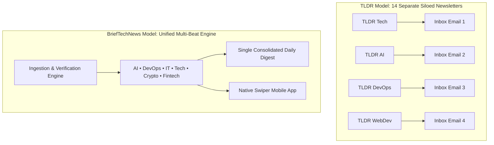

Every software engineer knows the morning information tax. Before you write your first line of code or review your first pull request, you need to know if production is burning, if an upstream package introduced a critical zero-day, or if AWS quietly deprecated an API endpoint your infrastructure relies on.

For years, the standard answer was spending twenty minutes skimming Hacker News or doomscrolling through technical Twitter feeds. But algorithmic feeds are intentionally engineered for outrage, endless debate, and cognitive exhaustion.

To reclaim their mornings, developers turned to 5-minute curated daily digests.

Two names dominate this category in 2026: **TLDR** and **BriefTechNews**. Both promise to summarize the day's critical technical developments in the time it takes to brew a pour-over espresso. But underneath that simple pitch lie two fundamentally opposing engineering philosophies: a fragmented multi-list email model versus an integrated multi-beat intelligence platform.

Here is how they compare when evaluated by practicing engineers.

---

## Architectural Comparison: How the Feeds Are Built

The biggest difference between TLDR and BriefTechNews is not the length of their bullet points; it is their **feed architecture**.



### The TLDR Architecture: The Multi-List Silo
TLDR started in 2018 as a single daily email summarizing tech and science. As the tech industry specialized, TLDR expanded not by organizing stories within a single framework, but by spinning up separate autonomous mailing lists:
- *TLDR Tech* (General consumer tech, science, Big Tech headlines)
- *TLDR AI* (LLMs, research papers, AI product launches)
- *TLDR WebDev* (Frontend frameworks, CSS, JavaScript tooling)
- *TLDR DevOps* (Kubernetes, cloud platforms, CI/CD)
- *TLDR Information Security* (Breaches, CVEs, compliance)
- *...plus 9 other specialized verticals*

If you are a full-stack engineer or tech lead whose responsibilities span infrastructure, machine learning APIs, and frontend systems, you have to subscribe to three or four separate TLDR lists. 

Every morning, you receive three to four distinct emails, each with its own intro, its own ad blocks, and its own footer. The 5-minute promise disappears, replaced by inbox triage.

### The BriefTechNews Architecture: The Multi-Beat Matrix
[BriefTechNews](https://brief-tech-news.com/) approaches developer intelligence as an integrated data stream. Instead of fracturing the audience across dozens of independent subscriber databases, BriefTechNews runs a unified curation engine that tags, scores, and groups stories into standardized technical beats:
- **AI**: Model releases, inference benchmarks, quantization breakthroughs, agent frameworks.
- **DevOps**: Kubernetes updates, container runtimes, observability pipelines, cloud cost shifts.
- **IT & Security**: Kernel CVEs, zero-days, enterprise networking, identity infrastructure.
- **Tech**: Hardware breakthroughs, developer platforms, major industry mergers.
- **Fintech & Crypto**: Payment protocols, ledger systems, decentralized infrastructure.

You receive **one email** or open **one mobile app interface**. The editorial engine synthesizes cross-discipline news. If an AI breakthrough impacts infrastructure costs (for example, a new distributed inference kernel reducing H100 memory bandwidth requirements), it is contextualized for both ML engineers and platform operators.

---

## Head-to-Head Feature Matrix

| Feature | TLDR | BriefTechNews |
| :--- | :--- | :--- |
| **Primary Medium** | Email only | Email + Native iOS & Android Swiper App |
| **Inbox Footprint** | 1 email per vertical (up to 4+ daily) | 1 single structured briefing per day |
| **Daily Read Time** | 5 mins per edition (15–20 mins across stacks) | 3–5 minutes total |
| **Cross-Stack Coverage** | Siloed by separate subscriptions | Unified multi-beat view (AI, DevOps, IT, Tech) |
| **Technical Depth** | Broad (mix of general tech & dev topics) | Deep (engineering metrics, benchmarks, CVEs) |
| **Primary Sourcing** | Mixed (links to blogs, news outlets, GitHub) | Direct (PRs, research papers, CVE IDs, release diffs) |
| **Advertising Density** | 2–3 dedicated sponsored blurbs per edition | Non-intrusive sponsor support; pure content focus |
| **Offline Reading** | Email client dependent | Offline-first native mobile caching |
| **Read-Later Workflow** | Manual browser bookmarking / forward | Built-in swipe-to-save stash in app |

---

## Editorial Depth: Skimming vs. Engineering Context

To understand the difference in signal quality, let's look at how both publications report on the same breaking technical event: a high-severity Linux kernel vulnerability.

### How TLDR Typically Covers an Exploit:
> **Linux Kernel Bug Discovered (3 minute read)**  
> Researchers have identified a new memory corruption flaw in the Linux kernel that could allow unprivileged local users to gain root permissions on vulnerable machines. Patches are currently rolling out to Ubuntu and Debian mirrors. [Link to generic tech blog article]

### How BriefTechNews Covers the Same Exploit:
> **CVE-2026-4892: Linux Local Privilege Escalation via eBPF Verifier Flaw**  
> A race condition in the kernel's eBPF bytecode verifier (kernels 6.4 through 6.12) permits arbitrary memory writes, enabling root escalation from an unprivileged container. Ubuntu (USN-7812-1) and Debian have pushed patched kernel builds. Upstream git commit `8d4f2b1` addresses the bounds check. Temporary mitigation: set `kernel.unprivileged_bpf_disabled = 1` via `sysctl`. [Direct Link to Kernel.org Patch Diff & Exploit PoC]

The difference is immediately clear. TLDR provides an executive summary suitable for a casual observer. BriefTechNews provides the exact CVE identifier, affected kernel versions, security impact on containerized environments, upstream patch commit, and immediate `sysctl` mitigation flag.

As a senior engineer, the second format allows you to take action immediately: check your fleet's kernel versions, apply the sysctl mitigation in your Ansible playbook, and verify your base Docker images before your first coffee cup is empty.

---

## Reading Experience: The Native Mobile App Advantage

One persistent friction point with email newsletters is the email client itself. 

Email apps are designed for communication, task management, and incoming emergencies. Opening your inbox to read a newsletter puts you inside a high-stress environment: unread client messages, Jira notifications, and calendar invites compete for your attention.

```
Reading in Gmail / Outlook:
[Inbox Notification] -> [Urgent Client Bug] -> [Jira Ping] -> Context Lost

Reading in BriefTechNews Mobile:
[Clean Card Interface] -> Swipe Left (Skip) -> Swipe Right (Save to Read-Later) -> Done
```

BriefTechNews engineered a dedicated mobile app (available on iOS and Android) that isolates your technical briefing from your communications pipeline:
1. **Swipeable Cards**: Stories are presented as focused briefing cards. Skim the headline and key engineering metrics.
2. **Offline First**: All issues are cached locally on your device, allowing you to read during an underground subway commute or flight without waiting for asset loading.
3. **Read-Later Stash**: Instead of leaving 14 Chrome tabs open on your phone, swipe right to save technical deep dives into a local offline reading queue for your lunch break.
4. **Built-in AI Analyst**: An interactive technical assistant grounded exclusively in verified technical documents lets you ask clarifying questions about architecture or benchmarks directly within the app.

TLDR has no native mobile reading interface; reading its issues on a smartphone requires scrolling through standard HTML emails with varying responsive rendering.

---

## Monetization and Ad Intrusiveness

Both services operate free tiers supported by corporate sponsorship. However, their advertising models impact the reading experience differently:

### TLDR's Advertising Strategy
TLDR relies heavily on sponsored text ads that mirror the visual formatting of its organic editorial items. A typical edition contains two prominent sponsored listings, often pitching SaaS products, developer conferences, or recruiting services. 

While clearly marked with a `(Sponsor)` tag, their visual styling identical to organic links requires extra mental parsing while scanning.

### BriefTechNews's Clean Signal Strategy
BriefTechNews maintains strict separation between editorial content and corporate partnerships. Sponsorships do not mimic organic CVE alerts or model benchmark reviews. 

The editorial voice remains aggressively objective, prioritizing developer utility over sponsor narrative.

---

## When to Choose TLDR

TLDR is a massive publication with over a million readers for a reason. You should choose TLDR if:
- **You want a broad, general tech industry scan**: If you enjoy reading about space exploration, consumer hardware gadgets, venture capital rounds, and social media trends alongside software news.
- **You specialize narrowly in one vertical**: If you are a pure frontend developer who only wants React and CSS updates (via *TLDR WebDev*) and does not care about Linux internals, database engines, or infrastructure pricing.
- **You prefer the traditional link-digest format**: If you simply want a laundry list of interesting URLs to click through and explore on your own.

---

## When to Choose BriefTechNews

BriefTechNews was designed from the ground up for software builders and infrastructure engineers. You should choose BriefTechNews if:
- **You want complete cross-stack coverage in one place**: You want AI, DevOps, security, and systems news synthesized into a single morning brief without subscribing to four different newsletters.
- **You demand primary-source engineering facts**: You need CVE numbers, model benchmark scores, git diffs, and architectural post-mortems rather than secondhand summaries.
- **You want to get out of your email inbox**: You prefer consuming your daily technical update in a dedicated, distraction-free mobile swiper app.
- **Your time is strictly budgeted**: You need the absolute highest signal-to-noise ratio possible so you can close your feed and focus on shipping code.

---

## The Verdict

TLDR is the digital equivalent of a broad technical newspaper: comprehensive, general, and wide-ranging.

BriefTechNews is an engineering dashboard: concise, dense, technically rigorous, and optimized for builders who value their time above all else.

For software engineers, platform architects, and engineering leaders tasked with keeping production online, **BriefTechNews is the superior daily briefing tool**.
